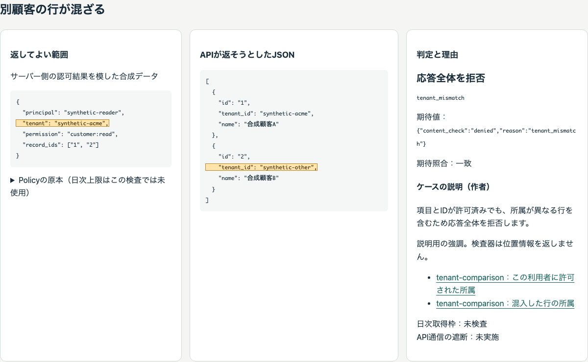
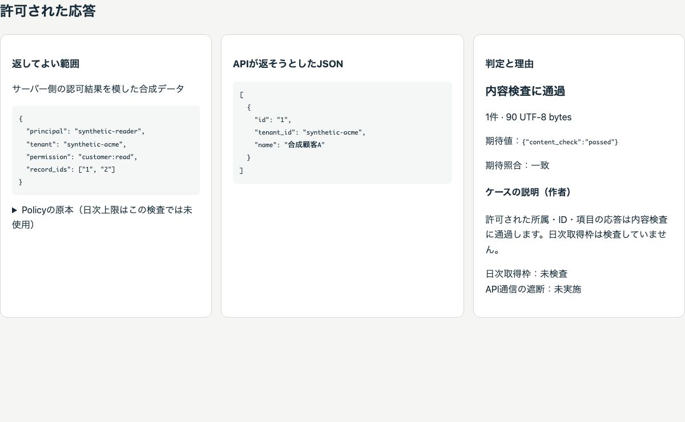

# veil-boundary-lab

「このレスポンス、返していい？」を、合成ケースと実際のLeakFence検査結果で確かめるオフラインの検査ラボ。

秘密らしい文字列がなくても、別顧客のレコードを返せば情報の越境は起こります。
誰に何を返してよいか、APIが返そうとしたJSON、実際の判定を並べて、その違いを説明します。

**M2を実装・検証済みです。CLIで5ケースを照合し、JSONと単一のオフラインHTMLを保存できます。**



合成データによる実行済みの内容検査結果です。黄色は作者の説明用注釈で、検査器が返した位置情報ではありません。日次取得枠は未検査です。

<details>
<summary>正常応答と他テナント混入をGIFで比較する</summary>



ブラウザ内で検査を実行する動画ではなく、保存済み結果の切り替えです。静止画と本文でも同じ違いを確認できます。

</details>

## 今回のゴール

- 最終ゴール：LeakFenceの役割と限界を理解し、自分のAPIでの導入検討へ進める入口を作る。
- 現在のマイルストーン：M3の引渡し準備と別配置での自己再現。第三者確認は未実施。
- 今回のタスク：配布物・再現手順・確認記録様式を作り、同じMacの別配置で再実行する。

実装の完了と、第三者に説明が伝わったこと、LeakFenceが本番で有効なことは別々に扱います。
このラボは内容検査のデモです。認証・認可の正しさ、日次取得枠、稼働APIの通信遮断は検証しません。

## 設計文書

| 文書 | 内容 |
| --- | --- |
| [設計](docs/DESIGN.md) | 不足点、対象範囲、構成、画面、失敗時の振る舞い |
| [データ契約](docs/DATA_CONTRACT.md) | ケース、結果、ハイライト、CLIの契約 |
| [実装タスク](docs/TASKS.md) | 依存順、変更対象、受け入れ条件、実装時の禁止事項 |
| [マイルストーン](docs/MILESTONES.md) | 段階ごとのゴール、終了条件、継続・縮小判断 |
| [確認した根拠](docs/EVIDENCE.md) | 参照コミット、実装上の事実、今回の検証範囲 |
| [M1の検証記録](docs/VALIDATION_M1.md) | 実行環境、完了条件と結果、依存確認、残る制約 |

## M1の使い方

Rust/rustupを用意し、リポジトリのルートから実行します。
Homebrewのcargo等がrustupより優先される環境でも同じツールチェーンを使えるよう、明示的に1.95.0を指定しています。

```sh
rustup run 1.95.0 cargo run --locked -- check
rustup run 1.95.0 cargo run --locked -- build --out out/demo-001
```

1.95.0が未導入なら先に`rustup toolchain install 1.95.0 --profile minimal`で取得します。
初回のツールチェーン・依存取得にはネットワークが必要です。取得後は`--locked`を`--frozen`に変えてCargoのネットワーク取得を禁止できます。

`check`は期待結果を照合するだけで、成果物を保存しません。`build`は`report.json`と`index.html`を新しい出力先へ保存します。HTMLは直接ブラウザで開けます。
既存の出力先を上書きしないので、再実行は`out/demo-002`等の別名にしてください。途中保存失敗時の部分ファイルも保全します。
レポートは本文・Policy・Contextをすべて保存します。合成データだけで使用してください。

終了コードは0が期待一致、2が実判定と期待の不一致、1が入力・引数・I/O等の実行失敗です。
**拒否が期待どおりなら0**であり、上流CLIの内容拒否の終了コードとは意味が異なります。

正常・他テナント混入・同一テナントの未許可ID・追加項目・許可値の意味を検査しない制約の5ケースがあります。
同じ結果から外部素材・JavaScript・サーバーを必要としない単一HTMLを生成します。第三者による再現確認はM3に残っています。

## 開発時の検証

```sh
rustup run 1.95.0 cargo fmt --all --check
rustup run 1.95.0 cargo test --locked
rustup run 1.95.0 cargo clippy --locked --all-targets -- -D warnings
```

試験用のコピーと出力は`out/test-runs/`に残します。自動削除は行いません。

自分のポリシー・応答を検査する場合は、本文をレポートへ保存するラボより先に、
[LeakFenceの既存CLIと導入ガイド](https://github.com/mt4110/leak-fence/blob/6a0f416e23da5e0cff5890fd05b6b1d9a4162393/docs/QUICKSTART.md)を参照してください。
そのCLIは本文を表示・保存せず、固定理由と件数・バイト数を返します。

公開、GitHub Issue・PR作成、LeakFence本体の変更は今回の作業に含めません。

M2の実施条件と制約は[検証記録](docs/VALIDATION_M2.md)を参照してください。

## 再現用の引渡し準備

[配布物からの再現手順](docs/REPRODUCE.md)、[確認記録の未記入様式](docs/REPRODUCTION_RECORD.md)、[自己再現の検証記録](docs/VALIDATION_M3_PREP.md)を用意しています。第三者確認は未実施で、M3全体は未完了です。

作業者向け：`python3 tools/package_source.py out/new-handoff`でソースとファイルごとのmanifestを梱包し、外側にSHA256SUMSを生成できます。既存の出力先を置換しません。Pythonは梱包用で、受取側のデモ実行には不要です。
